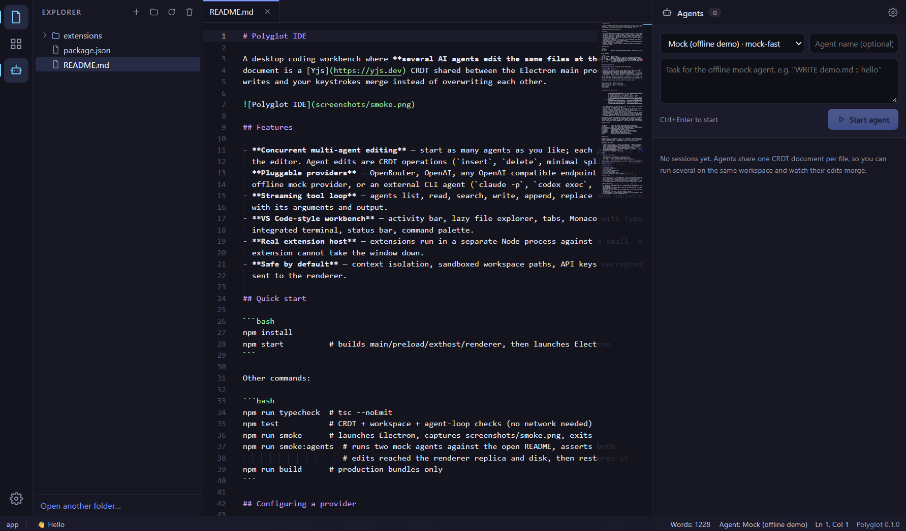

# MultiCoder

A desktop coding workbench where **several AI agents edit the same files at the same time as you do**. Every open
document is a [Yjs](https://yjs.dev) CRDT shared between the Electron main process and the Monaco editor, so agent
writes and your keystrokes merge instead of overwriting each other.



## Features

- **Concurrent multi-agent editing** — start as many agents as you like; each gets its own colour and live edit badge in
  the editor. Agent edits are CRDT operations (`insert`, `delete`, minimal splices), not whole-file overwrites.
- **Pluggable providers** — OpenRouter, OpenAI, any OpenAI-compatible endpoint (Ollama, vLLM, LiteLLM, LM Studio…), an
  offline mock provider, or an external CLI agent (`claude -p`, `codex exec`, `opencode run`, …).
- **Streaming tool loop** — agents list, read, search, write, append, replace and delete files. Every tool call is shown
  with its arguments and output.
- **Integrated window chrome** — the window is frameless; a title bar built into the app carries the brand, the workspace
  breadcrumb, quick actions and the real minimise/maximise/close controls, plus a greeting on launch.
- **VS Code-style workbench** — activity bar, lazy file explorer, tabs, Monaco with TypeScript/JSON/CSS/HTML workers,
  integrated terminal, status bar, command palette.
- **Real extension host** — extensions run in a separate Node process against a small `vscode` API shim, so a broken
  extension cannot take the window down.
- **Safe by default** — context isolation, sandboxed workspace paths, API keys encrypted with the OS keychain and never
  sent to the renderer.

## Quick start

```bash
npm install
npm start          # builds main/preload/exthost/renderer, then launches Electron
```

Other commands:

```bash
npm run typecheck  # tsc --noEmit
npm test           # CRDT + workspace + agent-loop checks (no network needed)
npm run smoke      # launches Electron, captures screenshots/smoke.png, exits
npm run smoke:agents  # runs two mock agents against the open README, asserts both
                      # edits reached the renderer replica and disk, then restores it
npm run build      # production bundles only
```

## Configuring a provider

Open **Settings** (Ctrl+, or the gear in the activity bar).

| Provider | What to fill in |
| --- | --- |
| **OpenRouter** | Paste an OpenRouter key. Default model: `anthropic/claude-3.5-sonnet`. |
| **OpenAI** | Paste an OpenAI key. Default model: `gpt-4o-mini`. |
| **Custom endpoint** | Base URL of any OpenAI-compatible API, e.g. `http://localhost:11434/v1` for Ollama, and a model name. |
| **Mock (offline demo)** | No key. Deterministic scripted agent, ideal for trying the multi-agent merge behaviour. |
| **CLI agent** | Command such as `claude -p` / `codex exec`. Use `{prompt}` as an explicit placeholder; otherwise the prompt is appended. |

API keys are stored encrypted with Electron `safeStorage` in the user-data directory. The renderer only ever sees a
`hasKey` flag. With no key the agent panel shows an inline hint linking back to Settings.

Mock prompt directives (one per line, useful for demos and tests):

```
WRITE notes/plan.md :: # Plan\n- step one
APPEND ACTIVITY.md :: agent B touched this
REPLACE src/app.ts :: const a = 1 => const a = 2
READ src/app.ts
DELETE tmp.txt
```

## How concurrent editing works

```
             ┌──────────────────────────── main process ───────────────────────────┐
             │  CollabHub: one Y.Doc + Y.Text per open file                        │
             │   • agent tools mutate Y.Text (append / replace / splice)           │
             │   • debounced persistence to disk (serialised per file)             │
             │   • workspace watcher merges external writes as a minimal splice   │
             └───────────────▲───────────────────────────────┬────────────────────┘
        Yjs update (IPC)     │                               │  Yjs update (IPC)
             ┌───────────────┴───────────────┐   ┌───────────▼────────────────────┐
             │ renderer Y.Doc  ── y-monaco ──▶│   │ external CLI agents / tools    │
             │ Monaco model (you type here)  │   │ write files directly           │
             └───────────────────────────────┘   └────────────────────────────────┘
```

- The main process owns the authoritative `Y.Doc` for each open file. The renderer keeps a replica and sends every
  local change as an incremental Yjs update.
- Tool calls such as `append_to_file` and `replace_in_file` mutate the shared `Y.Text` directly. Anything you typed
  elsewhere in the file is untouched, and Yjs does not require a lock.
- `write_file` applies the model's content as a prefix/suffix-minimal splice against the *live* text, so unrelated
  paragraphs survive even when an agent rewrites a section.
- External processes (CLI agents, extension writes) are picked up by the file watcher and merged with the same splice
  algorithm; the result is broadcast to the editor and decorated with the writing agent's colour.
- Persistence is debounced (350 ms) and serialised per file so an older write can never land after a newer one. With
  autosave disabled, Ctrl+S flushes explicitly; agent edits always persist their own results.

The automated checks cover the merge primitives, replica convergence, sandboxing, the mock tool loop, two agents
appending to one file simultaneously, and external-write merging (`npm test`). `npm run smoke:agents` additionally
drives the real Electron app: two mock agents append to the open README and the check verifies the text appears in
`window.polyglotDebug.docText('README.md')` (the renderer's CRDT replica) and on disk.

## Project layout

```
src/shared/        types, IPC channel names, CRDT text-splice helpers
src/main/          window, menu, IPC, workspace watcher, settings store
src/main/agents/   engine, tool definitions, OpenAI-compatible / mock / CLI providers
src/main/collab.ts Y.Doc hub shared by agents, disk and renderer
src/preload/       contextBridge API (window.polyglot)
src/exthost/       extension host process + mini vscode API + loader
src/renderer/      React workbench, Monaco/xterm wiring, Y.Doc replica
extensions/        sample extensions loaded by the host
tests/             executable checks (bundled with esbuild)
```

## Extensions

Extensions live in `extensions/` (built in), `<workspace>/.polyglot/extensions/`, or any absolute directory added in
Settings. Each folder needs a `package.json` with `name`, `main` and optionally `contributes.commands`; the entry point
exports `activate(context)` / `deactivate()` and can `require('vscode')`.

Implemented API subset:

- `commands.registerCommand`, `commands.executeCommand`, `commands.getCommands`
- `window.showInformationMessage` / `showWarningMessage` / `showErrorMessage`
- `window.createStatusBarItem(alignment, priority)` with `text`, `tooltip`, `command`, `show`, `hide`, `dispose`
- `window.activeTextDocument`, `window.onDidChangeActiveTextEditor`
- `workspace.workspaceFolders`, `workspace.fs.readFile` / `writeFile` / `stat`
- `workspace.onDidSaveTextDocument`
- `Uri.file` / `Uri.joinPath` / `Uri.parse`

Samples:

| Extension | Demonstrates |
| --- | --- |
| `hello-commands` | a command plus a status-bar item |
| `word-count` | reacting to save/active-document events |
| `file-header` | writing to the workspace through `workspace.fs` |

Commands appear in the command palette (Ctrl+Shift+P) and in the Extensions view.

## Keyboard shortcuts

| Shortcut | Action |
| --- | --- |
| Ctrl+O | Open folder |
| Ctrl+S | Save active file |
| Ctrl+, | Settings |
| Ctrl+Shift+P | Command palette |
| Ctrl+` | Toggle terminal |
| Ctrl+Alt+A | Toggle agent panel |
| Ctrl+Enter (in composer) | Start an agent |

## Security notes

- `contextIsolation: true`, `nodeIntegration: false`, and a CSP that only allows local scripts.
- Every filesystem path from the renderer or an agent is resolved inside the workspace root; escapes are rejected.
- Renderer ↔ main surface is the small typed API in `src/preload/index.ts`.
- The extension host is a separate process; it does not expose Node to the renderer.
- API keys are encrypted with the OS keychain and never leave the main process.

## Known limitations

- The terminal is pipe-based (no PTY), so interactive full-screen programs (vim, htop) do not work; builds, tests and
  git commands do.
- CRDT collaboration is between agents, disk and the editor **within one window**; there is no network sync between
  separate MultiCoder instances.
- Agent edits are shown as coloured inline badges with a hover label rather than persistent named cursors after the
  highlight fades.
- Only UTF-8 text files up to 2 MB can be opened or edited.
- The OpenAI-compatible provider expects streaming SSE; non-streaming-only endpoints are not supported.
- No git integration, diff view or debugging yet.
