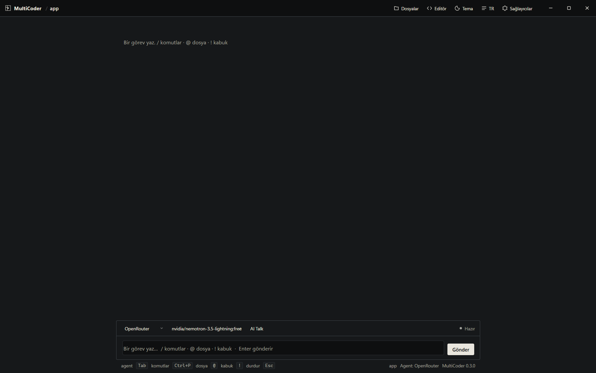

# MultiCoder

<p align="center">
  
</p>

<p align="center">
  <b>A desktop AI coding IDE where the model is your choice, not the vendor's.</b><br>
  Windows 10/11 · x64 · Electron 45
</p>

<p align="center">
  <a href="#english">English</a> · <a href="#türkçe">Türkçe</a> ·
  <a href="https://github.com/batuhanerkul40-cloud/multicoder/releases/latest">Download</a>
</p>

---

## English

**MultiCoder** is a desktop AI coding IDE for Windows. It puts a model-agnostic chat at the
center of the workspace and wraps it in the things you actually need while coding: a file
explorer, an editor panel, a command palette, and per-provider model settings.

It does not lock you into one vendor. Point it at any OpenAI-compatible endpoint — OpenRouter,
OpenAI, a local Ollama, or your own gateway — paste your key, and the app discovers that
provider's model list by itself. No hunting for model IDs, no editing config files.

### Highlights

- **Bring your own key.** Works with OpenRouter, OpenAI, and any OpenAI-compatible endpoint.
  The repository ships without keys; you add yours locally.
- **Automatic model discovery.** The provider's `GET /models` list is fetched and cached for
  5 minutes. Type `claude` to filter, pick with the arrow keys, `Esc` to close.
- **Chat-first shell.** A single conversation flow with one composer at the bottom. The activity
  bar, side panels and tabs stay hidden until you ask for them.
- **Editor and explorer on demand.** `Ctrl+B` opens the file drawer, `Ctrl+E` the editor panel,
  and files open in a slide-in editor.
- **Themes and typography.** Zen color palettes plus 14 type presets, all drawn from fonts that
  already ship with Windows — nothing is downloaded.
- **Turkish / English UI.** Switch from the title bar at any time.
- **Local-first settings.** API keys are encrypted with the operating system keystore
  (`safeStorage`) and never sent anywhere but the provider you configured.

### Download

**[⬇ MultiCoder-Setup-0.2.1.exe](https://github.com/batuhanerkul40-cloud/multicoder/releases/download/v0.2.1/MultiCoder-Setup-0.2.1.exe)** — 118.8 MB, Windows x64

All versions: [Releases](https://github.com/batuhanerkul40-cloud/multicoder/releases)

> The installer is **not code-signed**, so Windows SmartScreen will show "Unknown publisher".
> Click **More info → Run anyway** to continue. Everything it installs is listed in this
> repository.

The installer creates Start menu and desktop shortcuts, installs per-user into
`%LOCALAPPDATA%\Programs\MultiCoder`, and can be removed from *Apps & features*.

### First run

1. Launch MultiCoder.
2. Press `Ctrl+,` or click **Providers** in the title bar.
3. Choose a provider preset (OpenRouter, OpenAI, or *Custom endpoint*), paste your API key, and
   set the Base URL if you are using your own gateway.
4. Click **Save settings**. The window stays open, the key shows as `stored`, and the model list
   refreshes in the background.
5. Click the **Model** field and pick a model from the discovered list.

### Keyboard shortcuts

| Key | Action |
| --- | --- |
| `Enter` / `Shift+Enter` | send / new line |
| `Tab` / `Shift+Tab` | switch provider (agent) |
| `Esc` | stop the stream, close the open layer |
| `Ctrl+P` | command palette |
| `Ctrl+B` | file explorer drawer |
| `Ctrl+E` | toggle the editor panel |
| `Ctrl+N` | new session |
| `Ctrl+,` | provider settings |
| `/` · `@` · `!` | command · file reference · shell command |

Commands: `/new`, `/sessions`, `/model`, `/provider`, `/theme`, `/language`, `/files`,
`/editor`, `/extensions`, `/detail`, `/stop`, `/classic`, `/help`.

### Build the installer from this repository

This repository ships the **packaged** application (`MultiCoder/resources/app`), not the original
TypeScript sources, so electron-builder wraps the existing build:

```bash
npx electron-builder@latest --prepackaged "MultiCoder" --win nsis --x64 --config.electronVersion=45.0.0
```

Output: `installer/MultiCoder-Setup-0.2.1.exe`.

### Project status

MultiCoder is built on the Polyglot IDE codebase. The original `src/` sources are not part of
this repository; changes are made against the compiled `dist` bundle, which is why the technical
notes below map file by file.

---

## Türkçe

**MultiCoder**, Windows için masaüstü bir yapay zekâ kodlama IDE'sidir. Modelden bağımsız sohbeti
çalışma alanının merkezine koyar ve etrafını kod yazarken gerçekten ihtiyaç duyduğun şeylerle
sarar: dosya gezgini, editör paneli, komut paleti ve sağlayıcı bazlı model ayarları.

Seni tek bir firmaya bağlamaz. OpenRouter, OpenAI, yerel Ollama ya da kendi ağ geçidin gibi
**OpenAI uyumlu herhangi bir uç noktayı** göster, anahtarını yapıştır; uygulama o sağlayıcının
model listesini kendisi bulur. Model kimliği aramak, yapılandırma dosyası düzenlemek yok.

### Öne çıkanlar

- **Anahtar senin.** OpenRouter, OpenAI ve OpenAI uyumlu tüm uç noktalarla çalışır. Depoda
  hiçbir anahtar yoktur; anahtarını yalnızca kendi makinede girersin.
- **Otomatik model keşfi.** Sağlayıcının `GET /models` listesi alınır ve 5 dakika önbelleklenir.
  `claude` yazarak filtrele, ok tuşlarıyla seç, `Esc` ile kapat.
- **Sohbet odaklı kabuk.** Altta tek bir besteci, ortada tek bir konuşma akışı. Etkinlik çubuğu,
  yan paneller ve sekmeler sen çağırana kadar görünmez.
- **İsteğe bağlı editör ve gezgin.** `Ctrl+B` dosya çekmecesini, `Ctrl+E` editör panelini açar;
  dosyalar sağdan kayarak gelen editörde düzenlenir.
- **Tema ve yazı biçimi.** Zen renk paletleri ve 14 yazı biçimi ön ayarı — hepsi Windows'la
  birlikte gelen yazı tiplerinden, internetten indirme yok.
- **Türkçe / İngilizce arayüz.** Başlık çubuğundan anında değiştirilir.
- **Yerel öncelikli ayarlar.** API anahtarları işletim sisteminin güvenli deposuyla
  (`safeStorage`) şifrelenir; yapılandırdığın sağlayıcıdan başka hiçbir yere gitmez.

### İndirme

**[⬇ MultiCoder-Setup-0.2.1.exe](https://github.com/batuhanerkul40-cloud/multicoder/releases/download/v0.2.1/MultiCoder-Setup-0.2.1.exe)** — 118,8 MB, Windows x64

Tüm sürümler: [Releases](https://github.com/batuhanerkul40-cloud/multicoder/releases)

> Kurulum dosyası **imzasızdır**; Windows SmartScreen "Bilinmeyen yayıncı" uyarısı verir.
> Devam etmek için **Daha fazla bilgi → Yine de çalıştır** yolunu izle. Kurduğu her şey bu
> depoda görülebilir.

Kurulum Başlat menüsü ve masaüstü kısayolları oluşturur, kullanıcı bazlı olarak
`%LOCALAPPDATA%\Programs\MultiCoder` altına kurulur ve *Uygulamalar* listesinden kaldırılabilir.

### İlk çalıştırma

1. MultiCoder'i aç.
2. `Ctrl+,` tuşuna bas veya başlık çubuğundaki **Sağlayıcılar** çipine tıkla.
3. Bir sağlayıcı ön ayarı seç (OpenRouter, OpenAI veya *Özel uç nokta*), API anahtarını yapıştır;
   kendi ağ geçidini kullanıyorsan Base URL'yi gir.
4. **Save settings** düğmesine bas. Pencere kapanmaz, anahtar `stored` olarak görünür ve model
   listesi arka planda tazelenir.
5. **Model** alanına tıkla ve bulunan listeden bir model seç.

### Klavye kısayolları

| Tuş | İşlev |
| --- | --- |
| `Enter` / `Shift+Enter` | gönder / yeni satır |
| `Tab` / `Shift+Tab` | sağlayıcı (agent) değiştir |
| `Esc` | akışı durdur, açık katmanı kapat |
| `Ctrl+P` | komut paleti |
| `Ctrl+B` | dosya gezgini çekmecesi |
| `Ctrl+E` | editör panelini aç/kapat |
| `Ctrl+N` | yeni oturum |
| `Ctrl+,` | sağlayıcı ayarları |
| `/` · `@` · `!` | komut · dosya referansı · kabuk komutu |

Komutlar: `/yeni`, `/oturumlar`, `/model`, `/sağlayıcı`, `/tema`, `/dil`, `/dosyalar`, `/editör`,
`/eklentiler`, `/detay`, `/durdur`, `/classic`, `/yardım`.

### Bu depodan kurulum dosyası üretmek

Depo, orijinal TypeScript kaynaklarını değil **paketlenmiş** uygulamayı
(`MultiCoder/resources/app`) içerir; bu yüzden electron-builder mevcut derlemeyi sarmalar:

```bash
npx electron-builder@latest --prepackaged "MultiCoder" --win nsis --x64 --config.electronVersion=45.0.0
```

Çıktı: `installer/MultiCoder-Setup-0.2.1.exe`.

### Proje durumu

MultiCoder, Polyglot IDE kod tabanı üzerine kurulmuştur. Orijinal `src/` kaynakları bu depoda
yoktur; değişiklikler derlenmiş `dist` paketi üzerinde yapılır. Aşağıdaki teknik notlar bu yüzden
dosya dosya eşleme içerir.

---

## Teknik notlar

### Sade kabuk (opencode tarzı)

Uygulama açılışta opencode'un tek akışlı düzenini kullanır: etkinlik çubuğu, dosya gezgini,
sekmeler, durum çubuğu ve sağdaki agent paneli gizlenir; yerine tek bir sohbet akışı ve altta
tek bir besteci kalır. Renkler mevcut zen temalarından gelir, arayüz TR/EN'dir.

Eski VS Code düzenine dönmek için `/classic` (veya Ctrl+P → "Klasik düzen"); tercih
`localStorage.pg.skin` içinde saklanır. Dosyalar `Ctrl+B` çekmecesinden açılır, seçilen dosya
sağdan kayarak gelen editör panelinde düzenlenir. Tool çağrıları tek satırdadır; satıra
tıklayınca argüman ve çıktı açılır (`/detay` varsayılanı değiştirir).

Kabuk `resources/app/dist/renderer/assets/oc-shell.js` + `oc-shell.css` dosyalarından gelir ve
`index.html`'e eklenen iki satırla yüklenir. Oturum köprüsü `chat-workbench.js` içindeki
`window.pgWorkbench` nesnesidir.

### Birleşik başlık çubuğu ve karşılama

Pencere çerçevesizdir (`frame: false`); Windows'un başlık çubuğu ile `File / View / Help` menüsü
kaldırıldı. Yerlerine programla aynı yüzeyde duran 40px'lik bir başlık çubuğu geldi:

- Solda marka ve çalışma alanı adı (`MultiCoder / proje`), sağda **Dosyalar**, **Editör**, **Tema**,
  **TR/EN** ve **Sağlayıcılar** çipleri. Sağlayıcılar çipi, sağlayıcı/anahtar penceresini açar.
- Sağlayıcılar penceresi gibi React diyalogları açıkken karşılama ekranı çekilir; tıklamaları
  yutmaz, pencere donmuş gibi görünmez.
- En sağda gerçek pencere kontrolleri: küçült, büyüt/geri al, kapat. Çubuk sürüklenerek pencere
  taşınır, çift tıklama büyütür; düğmeler sürükleme alanının dışındadır.
- Menünün kısayolları (Ctrl+O, Ctrl+S, Ctrl+, vb.) çalışmaya devam eder; `File / View / Help`
  yalnızca görünmez, işlevleri başlık çubuğu ve komut paletinde durur.
- `/classic` düzeninde de başlık çubuğu kalır, altındaki eski VS Code düzeni 40px aşağıdan başlar.

Karşılama ekranı yalnızca açılışta ve çalışma alanı kapalıyken görünür: enso işareti, rastgele
getirilen bir karşılama cümlesi ("Hoş geldin!", "Merhaba!", "Nasılsın?", "Naber?" — bazen
"Bugün ne yapıyoruz?" / "Bugün aklında ne var?" ile birleşik) ve **Klasör aç** / **Komutlar**
düğmeleri. İşaret büyüyerek, satırlar sırayla yukarı kayarak gelir; `prefers-reduced-motion`
açıksa animasyon kapanır. Karşılama, bir klasör açılınca ya da ilk mesaj gönderilince kaybolur.

### Yazı biçimleri (Tema penceresi)

**Tema** çipinde iki bölüm var: **Renk teması** (zen paletleri) ve **Yazı biçimi · 14**. Her yazı
biçimi kartındaki "Aa" örneği o yazı tipiyle çizilir; seçim anında uygulanır ve `pg.type` olarak
saklanır. Ön ayarlar: Zen, Modern, Hümanist, Okuma, Gazete, Dergi, Teknik, Mühendis, Edebi, Sakin,
Keskin, Sade, Terminal, Sıcak. Hepsi Windows'la birlikte gelen yazı tiplerinden kuruludur
(Palatino, Bahnschrift, Georgia, Book Antiqua, Cascadia, Sitka, Corbel, Century Gothic, Arial,
Consolas, Rockwell…) — internetten yazı tipi indirmez. Kod düzenleyicisi kendi sabit yazı tipini
korur; seçim arayüzü, sohbeti ve panelleri etkiler.

### 0.2.1'de ne değişti?

- **Save artık Sağlayıcılar penceresini kapatmıyor.** Kaydettikten sonra pencerede kalırsın; sağ altta
  "Ayarlar kaydedildi" bildirimi çıkar.
- **Model alanına tıklayınca altında liste açılıyor.** Her sağlayıcı kartında (OpenRouter, OpenAI,
  özel uç nokta) aynı davranış. Liste kaydırılabilir, üstteki **Yenile** düğmesiyle tazelenir.
- **Yazarken filtreleme:** model alanına "claude" yazınca liste daralır; ok tuşları + Enter ile
  seçim yapılabilir, **Esc** kapatır. Seçilen model hem alana hem React state'ine yazılır.
- **Anahtar kaydedilince liste otomatik tazelenir.** Yeni yapıştırdığın anahtar hemen kullanılır;
  "API key: stored" durumu da anında güncellenir.
- **Geçersiz anahtar uyarısı:** anahtarda ASCII dışı karakter (Türkçe harf, akıllı tırnak vb.)
  varsa panel bunu açıkça söyler. OpenRouter listesi anahtar gerekmediği için yine de dolar.
- **Mock / CLI agent** sağlayıcılarında model paneli açılmaz (model adı serbest metindir).

### Nasıl çalışıyor (teknik)

- Model listesi main process'te `GET {baseUrl}/models` ile alınır (20 sn zaman aşımı, 5 dk önbellek).
  `{data: []}`, `{models: []}` ve düz dizi biçimleri desteklenir; 401/403 ayrı mesajlanır.
- Anahtar kaydedilirken liste arka planda önceden çekilir (`settings:set-key`).
- Renderer'da `settings-saved` olayı dinlenir; kayıt sonrası tüm kartlar `refresh: true` ile
  yenilenir.
- Panel, Model input'unun altına `position: fixed` olarak yerleşir; modal kaydırılınca yeniden
  konumlanır. React'in kontrollü input'una yazım native setter + `input` olayı ile yapılır.
- API anahtarı renderer'a hiç gitmez; `safeStorage` ile şifreli saklanmaya devam eder.

> **API anahtarları:** Depoda hiçbir anahtar tutulmaz. Anahtarını yalnızca uygulamanın
> Sağlayıcılar penceresine yapıştırıp **Save settings**'e bas; anahtar işletim sisteminin
> güvenli deposuyla (`safeStorage`) şifrelenerek yerel olarak saklanır. Anahtar ASCII dışı
> karakter içeriyorsa panel bunu "API anahtarında ASCII dışı karakter var…" diye bildirir;
> bu durumda anahtarı yeniden kopyalayıp yapıştırman yeterli.

### Değişen dosyalar

Uygulamanın `src/` kaynağı bu makinede yok; değişiklikler derlenmiş `dist` üzerinde yapıldı.

| Dosya | Değişiklik |
| --- | --- |
| `MultiCoder/resources/app/dist/main/index.cjs` | Çerçevesiz pencere, `win:*` IPC kanalları, MultiCoder adı; model keşif motoru, `settings:list-models` kanalı, anahtar kaydında ön çekme, ASCII dışı anahtar kontrolü. |
| `MultiCoder/resources/app/dist/preload/index.cjs` | `window.polyglot.win` (küçült / büyüt / kapat / durum) ve `window.polyglot.settings.listModels(...)` |
| `MultiCoder/resources/app/dist/renderer/assets/oc-shell.js` · `oc-shell.css` | Başlık çubuğu, pencere kontrolleri, karşılama ekranı ve sade kabuk. |
| `MultiCoder/resources/app/dist/renderer/assets/model-discovery.js` | Model alanına bağlı açılır liste, filtreleme, klavye, uyarılar, "Ayarlar kaydedildi" bildirimi. |
| `MultiCoder/resources/app/dist/renderer/assets/zen-themes.js` | 10 yeni yazı biçimi ön ayarı (toplam 14) ve `data-pg-type` değişkenleri. |
| `MultiCoder/resources/app/dist/renderer/index.html` | Yukarıdaki betikleri yükler (CSP `script-src 'self'` uyumlu). |
| `MultiCoder/resources/app/dist/renderer/assets/index-C9O_KBAP.js` | Save handler'da pencereyi kapatma çağrısı kaldırıldı; `hasKey` senkronu ve `settings-saved` olayı eklendi. Ayrıca `data-provider-id`, `data-polyglot-model`, `data-polyglot-base-url` öznitelikleri. |

### Bilinen sınırlar

- Liste, sağlayıcının OpenAI uyumlu `GET /models` uç noktasına dayanır. Bu uç noktayı sunmayan
  sağlayıcılarda model elle girilir.
- Ollama gibi yerel sunucularda Base URL `http://localhost:11434/v1` olmalı.
- Save artık pencereyi kapatmadığı için kapatmak isteyen **Cancel** veya sağ üstteki **X**'i
  kullanmalı.
- Kurulum dosyası imzasızdır; SmartScreen uyarısı beklenen davranıştır.
